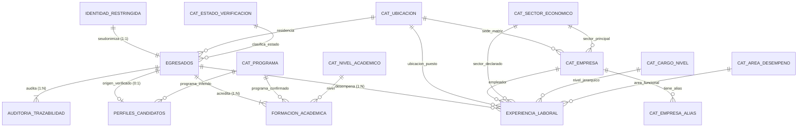

## 2. Modelo relacional definitivo

El modelo se organiza en **tres esquemas separados** dentro de PostgreSQL 14+:

1. **Esquema `catalogos` (8 tablas de referencia):** Estandariza ubicaciones geográficas (`cat_ubicacion`), programas curriculares (`cat_programa`), niveles académicos (`cat_nivel_academico`), sectores económicos (`cat_sector_economico`), empresas empleadoras (`cat_empresa`) y sus alias (`cat_empresa_alias`), niveles jerárquicos (`cat_cargo_nivel`) y áreas de desempeño (`cat_area_desempeno`), además de estados de verificación.
2. **Esquema `boveda_identidad` (1 tabla restringida):** `identidad_restringida` resguarda la correspondencia $1:1$ entre el identificador subrogado `id_egresado` (`UUID`) y la referencia protegida del acta de grado, controlando el estado de autorización legal.
3. **Esquema `nucleo_analitico` (5 tablas operativas):**
   * `perfiles_candidatos`: Retiene en cuarentena casos dudosos u homónimos.
   * `egresados`: Entidad maestra seudonimizada de graduados confirmados.
   * `formacion_academica`: Títulos de pregrado y posgrado ($1:N$).
   * `experiencia_laboral`: Historial de cargos ($1:N$) con preservación de textos originales y estados de homologación.
   * `auditoria_trazabilidad`: Registro histórico de procedencia y calidad ($1:N$).



## 3. Estructura de carpetas

```text
seguimiento-egresados-linkedin/
│
├── database/
│   ├── schema.sql
│   ├── catalogos.sql
│   ├── load_mock_data.sql
│   └── quality_checks.sql
│
└── mock_data/
    ├── README.md
    ├── identidad_restringida_ficticia.csv
    ├── egresados.csv
    ├── perfiles_candidatos.csv
    ├── formacion_academica.csv
    ├── experiencia_laboral.csv
    └── auditoria_trazabilidad.csv
```

## 4. Implementación completa (Especificaciones de Archivos)

### Archivo: `database/schema.sql`
Debe crear los esquemas `catalogos`, `boveda_identidad` y `nucleo_analitico`. Incluir todas las tablas listadas en el DER con sus respectivas `PRIMARY KEY`, `FOREIGN KEY` (con `ON DELETE RESTRICT` o `CASCADE` según corresponda), y comprobaciones `CHECK` rigurosas (por ejemplo, asegurar que la `fecha_fin` sea mayor o igual a `fecha_inicio`, que no haya duplicados exactos en experiencia, y que un candidato en cuarentena NO tenga un `id_egresado_confirmado`).

### Archivo: `database/catalogos.sql`
Script `INSERT` con códigos oficiales verificados para ubicaciones (DIVIPOLA/ISO), niveles académicos (MEN), programas (SNIES), sectores (CIIU Rev. 4), niveles jerárquicos y áreas de desempeño (CUOC). Las empresas empleadoras deben incluir el sufijo `[SINTETICA]`.

### Archivo: `mock_data/README.md`
Aviso legal y técnico: Todos los datos son ficticios. Explicación de los 8 casos abordados en la demostración:
1. Trayectoria profesional completa (2 títulos, 3 empleos).
2. Movilidad internacional (Residencia en Colombia, empleo remoto en EE.UU.).
3. Fechas incompletas (Solo año conocido, almacena `YYYY-01-01` con bandera `precision_fecha = 'ANUAL'`).
4. Cargo ambiguo (Título de puesto extraño, pendiente de homologación).
5. Múltiples empleos actuales (Rol corporativo principal + Docencia de cátedra simultáneos).
6. Transición a sector no afín (Ingeniero en área comercial/ventas).
7. Homonimia sin resolver (Retenido en cuarentena en `perfiles_candidatos`, excluido de los confirmados).
8. Información desactualizada (Captura de mayo 2024, dispara alertas de obsolescencia).

### Archivos CSV (`mock_data/*.csv`)
Representan la fuente canónica de los 8 casos sintéticos obligatorios estructurados relacionalmente. Asegurarse de que los UUIDs e IDs foráneos coincidan perfectamente entre los archivos.

### Archivo: `database/load_mock_data.sql`
Bloque transaccional (`BEGIN; ... COMMIT;`) que primero trunca las tablas (`TRUNCATE ... RESTART IDENTITY;`) y luego importa secuencialmente los archivos utilizando `\copy`. El orden estricto de carga es: 1. `identidad_restringida`, 2. `egresados`, 3. `perfiles_candidatos`, 4. `formacion_academica`, 5. `experiencia_laboral`, 6. `auditoria_trazabilidad`.

### Archivo: `database/quality_checks.sql`
Vistas operativas y consultas que arrojan el reporte de calidad:
*   `vw_egresados_confirmados_indicadores`: Vista segura para BI.
*   `vw_experiencias_analitica`: Calcula duración en meses, excluyendo aquellos con precisión anual (Caso 3).
*   `vw_reporte_calidad_datos`: Unión (`UNION ALL`) de reglas (QC-01 a QC-06) detectando cuarentenas, fechas incompletas, homologaciones pendientes, datos obsoletos y pluriempleo legítimo.

## 5. Instrucciones de ejecución

Ejecutar desde el directorio raíz (`seguimiento-egresados-linkedin/`):

```bash
# 1. Crear la base de datos
createdb -U postgres -E UTF8 seguimiento_egresados_unal

# 2. Ejecutar esquemas y tablas
psql -U postgres -d seguimiento_egresados_unal -f database/schema.sql

# 3. Cargar los catálogos normalizados
psql -U postgres -d seguimiento_egresados_unal -f database/catalogos.sql

# 4. Importar los datos sintéticos (CSV)
psql -U postgres -d seguimiento_egresados_unal -f database/load_mock_data.sql

# 5. Ejecutar controles automáticos de calidad
psql -U postgres -d seguimiento_egresados_unal -f database/quality_checks.sql
```

## 6. Pruebas y resultados esperados

### Prueba 1: Integridad y Relaciones (Casos 1 al 8)
Una consulta agrupada por `id_egresado` a través de las tablas analíticas debe mostrar a 7 egresados confirmados, permitiendo identificar la movilidad y afinidad.
*   El Caso 1 tendrá 2 títulos y 3 empleos (1 actual).
*   El Caso 2 indicará movilidad `EXPORTACION_SERVICIOS_REMOTO`.
*   El Caso 4 mostrará afinidad nula (homologación pendiente).
*   El Caso 6 marcará `afin_ingenieria_actual = false`.

### Prueba 2: Protección contra homonimia y errores cronológicos
*   El perfil de homonimia (Caso 7, `CAND-SINT-0007`) debe hallarse confinado exclusivamente en `perfiles_candidatos` con estado `CUARENTENA_HOMONIMIA` y sin UUID confirmado. No puede insertarse en `egresados`.
*   El Caso 3 (fecha parcial) debe retornar `NULL` en el cálculo de duración de meses verificados para evitar sesgos analíticos al haber asumido enero (`01-01`) por defecto.

### Prueba 3: Auditoría Final (`quality_checks.sql`)
La vista unificada de calidad arrojará exactamente 5 advertencias:
1. `QC-01_CUARENTENA_IDENTIDAD`: Exclusión preventiva del Caso 7 por homonimia.
2. `QC-02_FECHA_PRECISION_LIMITADA`: Advertencia sobre el Caso 3 (precision_fecha = ANUAL).
3. `QC-03_HOMOLOGACION_PENDIENTE`: Advertencia de revisión manual del cargo ambiguo del Caso 4.
4. `QC-04_OBSOLESCENCIA_CRONOLOGICA`: Alerta del Caso 8 por tener una captura con antigüedad mayor a 18 meses.
5. `QC-06_PLURIEMPLEO_LEGITIMO_VALIDADO`: Aprobación controlada del Caso 5 (1 rol principal + 1 cátedra). No debe disparar la alerta QC-05 de colisión.